# 👑 GLOBAL SPIRIT AGENCY (UNITY INC) — MASTER OPERATIONS GUIDE 2026
## Автономный Центр Управления Агентством ИИ-Автоматизаций и B2B Продаж
_Статус: Внедрено в боевой контур виртуального офиса | Версия: 2026.1-autonomous_
_Партнёры-Основатели: @unityspiritpartners (Власлав) · @mshlomon (Шломо)_

---

## 1. 🎯 Миссия и 4 Опоры Роста Агентства

Агентство объединяет экспертизу холдинга **Unity Inc**, наработки внешней разведки (Ярослав Сажнев, JoinTECH, La Dagon Sector, Sysadmin Future) и мощь 7 автономных агентов Виртуального Офиса в единый высокомаржинальный бизнес:

```mermaid
flowchart TD
    subgraph P1 ["Опора 1: Высокочековый B2B AI-Консалтинг ($1,000–$3,500)"]
        P1_A["40-минутный стратегический звонок с ЛПР"] --> P1_B["Живой разбор 1 документа за 180 сек (метод Сажнева)"]
        P1_B --> P1_C["Блок киберзащиты данных от утечек в LLM (Sysadmin Future)"]
        P1_C --> P1_D["Продажа внедрения под ключ: CRM + AI-Ассистенты + Голосовой ресепшен"]
    end

    subgraph P2 ["Опора 2: Контент-Завод и AI-Видеопродакшн (Фермы Контента)"]
        P2_A["Медиа-активы Белграда: клиника + элитная недвижимость"] --> P2_B["Накладываем AI-аватаров дикторов (HeyGen + ElevenLabs)"]
        P2_B --> P2_C["3 языка: Русский, Английский, Сербский"]
        P2_C --> P2_D["Пакетный оффер '75 рилс за 7 дней' для франшиз и девелоперов"]
    end

    subgraph P3 ["Опора 3: Линейка IT-Продуктов (MRR Подписка)"]
        P3_A["TMA Навигатор Каналов (JoinTECH модель)"] --> P3_B["Встроенный AI-поиск по базе постов"]
        P3_B --> P3_C["Сборка за 2 часа через агента Fullstack"]
        P3_C --> P3_D["Тариф: 29 000 ₽ под ключ или 1 490 ₽/мес подписка"]
    end

    subgraph P4 ["Опора 4: Суверенная Инфраструктура & VPN 2026"]
        P4_A["Каскад RU Entry (Nginx Stream SNI)"] --> P4_B["XRay XHTTP Reality на иностранном выходе"]
        P4_B --> P4_C["Fail2ban + Self-Steal защита (Habr #1103460)"]
        P4_C --> P4_D["Изолированные клиенты без риска блокировок РКН"]
    end
```

---

## 2. 🤖 Штат из 7 Автономных Агентов Агентства

| № | Агент | Роль в Агентстве | Рабочий движок / Модель | Ключевой результат |
| :--- | :--- | :--- | :--- | :--- |
| **1** | **Директор Тим** | CEO & Главный Оркестратор | `gemini-flash` / `hybrid-openrouter` | Приём клиентских задач, координация отделов, контроль дедлайнов 24/7 |
| **2** | **Аналитик & Скаут** | B2B Lead Hunter & Data Scout | `deepseek-v3` / `gemini-flash` | Поиск ЛПР, парсинг ниш, аудит сайтов конкурентов, расчёт CPL ≤ $30 |
| **3** | **B2B Closer** | JoinTECH 40-Min Audit Architect | `claude-3-5-sonnet` / `gemini-pro` | 180-секундный живой разбор документов, расчёт упущенной выгоды, закрытие на $1,000–$3,500 |
| **4** | **Performance Lead** | GRIC Web & Traffic Engineer | `gemini-flash` / `open_weight` | Высококонверсионные посадочные страницы (CR 12–25%), реклама Pay-On-Results |
| **5** | **Content Producer** | True1 / Sazhnev Studio Lead | `veo-3` / `kling-v1.6` / `heygen` | Пакетное производство 75 Shorts/Reels/неделю, генерация видео-промптов |
| **6** | **Lead Fullstack** | TMA & Open V3 Store Builder | `claude-code` / `qwen2.5-coder` | Telegram Mini Apps, веб-витрины, автоматические интеграции N8N/CRM/Nango |
| **7** | **Cyber Sentinel** | Sysadmin Future & VPN 2026 | `sysadmin-core` / `bash-mesh` | Защита от утечек коммерческой тайны в LLM, развертывание каскадов VPN |

---

## 3. 💼 Каталог Услуг и Тарифная Сетка

1. **B2B AI-Экспресс Аудит (180 сек) & Дорожная Карта:**
   - *Цена:* 75 000 ₽ / $750 (0 ₽ при покупке комплексного пакета).
   - *Результат:* Живой разбор 1 реального договора/регламента ЛПР, оцифровка дыры в 35% клиентов, 6-узловая архитектура внедрения.
2. **Ферма Контента (75 Reels / Shorts за 7 дней):**
   - *Цена:* 120 000 ₽ / $1,200 под ключ.
   - *Результат:* 75 готовых роликов с цифровым диктором (HeyGen + ElevenLabs), субтитрами и промптами для Kling/Veo на 3 языках.
3. **Telegram Mini App «Навигатор + База Знаний»:**
   - *Цена:* 29 000 ₽ ($350) разовая сборка + 1 490 ₽/мес подписка на хостинг/обновления.
   - *Результат:* Каталог услуг в Telegram, мгновенный семантический поиск, прямая передача лидов в CRM.
4. **Комплексное Внедрение AI-Инфраструктуры Под Ключ:**
   - *Цена:* 250 000 ₽ ($2,500) с опцией Pay-On-Results.
   - *Результат:* Telegram Mini App + веб-витрина + Голосовой ресепшен 24/7 + суверенная защита данных.

---

## 4. ⚡ Инструменты Управления: Telegram & Local API

### Управление через Telegram (@unitybusinessbot):
- `/agency` — Главное интерактивное меню агентства (аудит, контент, цены, статус).
- `/agency_audit [Название или сайт клиента]` — Мгновенный запуск 180-секундного аудита по модели JoinTECH.
- `/agency_sprint [Тема контента]` — Автономная сборка недельного спринта из 7 Reels/Shorts.
- `/agency_status` — Актуальный статус всех 7 автономных агентов.

### Программный интерфейс (Local HTTP API на порту 18799):
- `GET http://127.0.0.1:18799/api/agency/status` — Полная телеметрия роя агентов и каталога услуг.
- `POST http://127.0.0.1:18799/api/agency/audit` — Автономная генерация аудита (принимает `{"client_name", "niche", "website_or_doc"}`).
- `POST http://127.0.0.1:18799/api/agency/sprint` — Генерация видео-спринта (`{"topic", "target_audience", "language"}`).
- `POST http://127.0.0.1:18799/api/agency/lead` — Регистрация нового лида прямо на Kanban-доску `board.json`.

---

## 5. 👥 Аудит и Статус Задач Партнёров

### Задачи Власлава (@unityspiritpartners):
- `#105` (Исследование Anthropic / Greg Brockman) — Анализ выполнен, резюме сохранено в отчётах Тима.
- `#107` (Xiaomi 14T specs & AmneziaVPN for Beeline) — Спецификации телефона добавлены в `BEELINE_SETUP_GUIDE.md` и разбор `Unity Inc`.
- `#108`–`#112`, `#117`–`#119` (Маркетинговые разборы, Reels, GRIC.Agency, LinkedIn) — Все исполнительные отчёты Директора Тима сформированы.
- **Вход в Офис со смартфона:** Ошибка мобильного входа устранена в релизе v35.0 (устранён сброс на регистрацию, синхронизированы пароли, убран скролл).

### Задачи Шломо (@mshlomon):
- `#106` (Регистрация REQ-029596) — Одобрена с правами полного доступа (`has_full_access: true`, `all_projects: true`).
- `#113` (Материалы Альберты по трансформации) — 60 файлов и 6 веб-страниц систематизированы в хабе.
- `#114` (Непробиваемый VPN 2026 по статьям Habr) — Собран полный production-дистрибутив (`HABR_UNBREAKABLE_VPN_2026.zip`).
- `#115` (Мобильная адаптивность Alberta Hub) — Устранены горизонтальные переполнения на 8 вкладках и 5 международных страницах (коммит `79ae31f`).
- `#116` (Патч мобильности для Татьяна tentorium.ru) — Доставлен и интегрирован.
- **Личный Офис @mshlomon:** Развернута персональная директория со всеми инструментами и правами тестирования.
